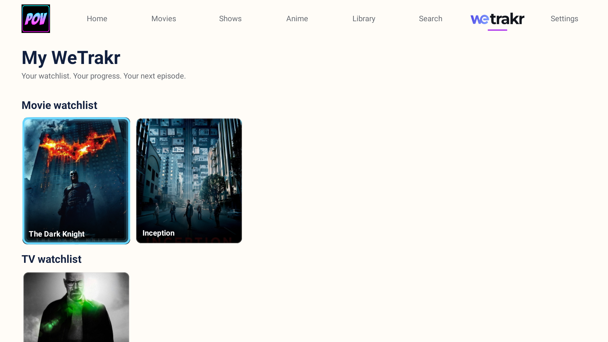
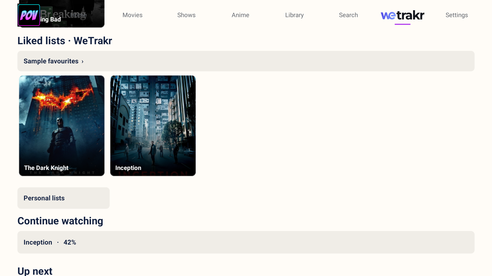
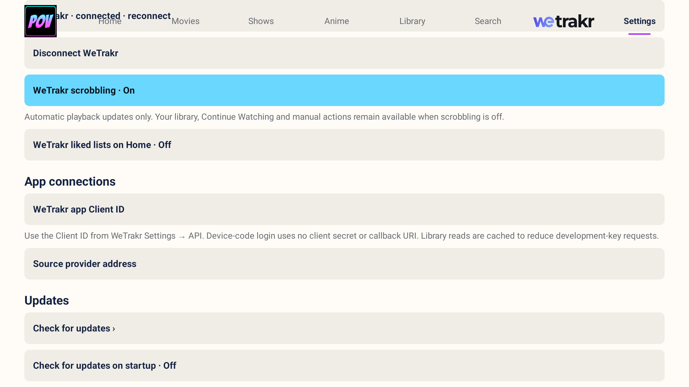
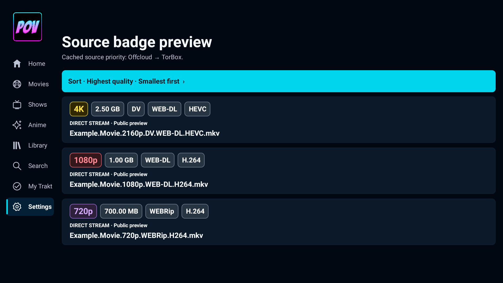

# POV Rajput for Android TV

### By Rajput

**A native Android TV app with Offcloud and TorBox cloud playback, WeTrakr tracking, five themes, anime browsing, and a Media3 player.** Kodi is not required.

This is **Rajput's Android TV edition**, forked from [MM-482/pov-android-tv](https://github.com/MM-482/pov-android-tv). The original Android TV port was created by **Mark Mateo**, based on the original POV Kodi add-on by **[kodifitzwell](https://github.com/kodifitzwell/repo)**. Their work, attribution, and GPL-3.0 license are preserved.

**[Download release APK](https://github.com/husnainahmedrana/pov-rajput-android-tv/releases/latest)** · **[Setup guide](docs/OFFCLOUD.md)** · **[Build and release](docs/BUILD_AND_RELEASE.md)** · **[Release notes](docs/RELEASE_NOTES.md)**

## Rajput's contributions

- Added WeTrakr-only device login, encrypted account tokens, watchlist/liked-list thumbnail shelves, remote Continue Watching, safe playback-session removal, and optional scrobbling. Users supply their own registered Client ID; no developer credentials are bundled.
- Added Offcloud API-key connection with Android Keystore encryption.
- Updated account validation to the current account API and Bearer authorization, replacing the retired proxy endpoint.
- Added JSON cache checks, cloud transfer preparation, download-status polling, cloud-history browsing, and exact file selection.
- Added encrypted 24-hour reuse of the last successfully played stream, with fresh source search when an expired link fails.
- Added keyboard Search/Enter submission and an optional microphone action using the TV voice service.
- Added Cinemeta New Movies, New Shows, Featured Movies, Featured Shows, Popular Movies and Popular Shows, expandable shelves, and retained pages when returning from details.
- Added conservative Cinemeta poster matching for cloud-library filenames without automatically assigning tracking identities.
- Added combined Offcloud/TorBox cache searches and selectable debrid priority, safe episode matching, duplicate-transfer prevention, and retry reuse for pending downloads.
- Improved the connection dialog with visible progress/errors and retained input when validation fails.
- Added account-change/cancellation guards and read-only ADB diagnostics that do not expose keys or playback links.
- Added transparent backgrounds, bold text, and Small/Medium/Large subtitle sizes for fullscreen and mini-player playback.
- Added a saved subtitle language preference, selected automatically when a matching track is available.
- Added a saved preferred audio language, with automatic selection and fallback when unavailable.
- Added a live subtitle-position slider in Settings and the player subtitle-style menu.
- Added one-second D-pad seeking with a target-time preview and seek on button release.
- Added direct cached playback: Offcloud avoids cloud transfers; TorBox resolves direct links and removes newly created cached entries before playback. Uncached downloads remain in the library.
- Added numbered debrid priorities with Move up / Move down controls.
- Added verified in-app updates from published GitHub releases and optional startup checks.
- Added long-press removal from Continue watching across all five themes and the WeTrakr page.
- Added automated debug/release APK builds, tests, lint reports, checksums, and signed APK publication to tagged GitHub Releases.

## Screenshots

Screenshots of POV Rajput for Android TV with the Editorial theme, using sample lists and public titles. Video playback and Android dialogs retain their standard styling.

### Home

### WeTrakr library

### Continue Watching from WeTrakr

### WeTrakr settings

### Settings

### Appearance

## Source providers

Open **Settings → Source providers** to add a name and HTTPS Stremio-compatible add-on URL for each scraper. Select a saved provider to turn it on or off, edit its name/address, or remove it. Disabling a provider keeps its configuration for later.

Search combines results from all enabled providers. Matching torrent hashes and file indexes, or identical direct URLs, appear once with the contributing provider names. Different torrent files and signed playback URLs remain separate. Quality/file-size sorting and debrid priority apply to the combined results. If one provider is unavailable, results from the others remain accessible.

## Discovery and search

Home shelf headings open a grid of their fetched titles. Everyone gets six Cinemeta shelves in this order: **New Movies, New Shows, Featured Movies, Featured Shows, Popular Movies, Popular Shows**. New uses the current-year catalog and filters inconsistent release years; Featured preserves Cinemeta’s own selection, without claiming a highest-rating order. No tracking account or API key is needed for these catalogs. WeTrakr supplies Continue Watching and optional liked lists, alongside its existing watchlist/library features.

The search dialog accepts the keyboard’s Search/Enter action directly. **Voice search** uses an installed TV speech-input activity; TVs without one retain keyboard search. Cloud-library posters use exact title/year matches from Cinemeta; ambiguous filenames keep their original labels and are never silently scrobbled as a guessed title.

## Features

| Area | Included |
| --- | --- |
| Offcloud | Bring-your-own API key, direct cached playback, cloud downloads, library, status, file selection |
| TorBox | Account connection, cloud libraries, cached playback with temporary-entry removal, direct links |
| WeTrakr | Own Client ID, device login, watchlists, liked lists, synced Continue Watching, Up Next, optional scrobbling |
| Catalog | Movie/show discovery, search, details, seasons, episodes, and anime browsing |
| Player | Native Media3, fullscreen/mini player, audio/subtitle choices, transparent subtitle backgrounds, bold subtitles, three subtitle sizes, resume, compatibility guard |
| Appearance | Editorial by default for new installs; Cinematic, Neon, Cinema, and Dashboard also available |
| TV | Android TV launcher, D-pad navigation, Android 8.0/API 26 or later |

Raw cloud files can play without a catalog identity. They are not silently assigned a guessed movie/episode for WeTrakr tracking. Offcloud account plans, limits, availability, and source-provider results remain controlled by their respective services.

## Install and connect

1. Download `POV-Rajput-release.apk` from [Releases](https://github.com/husnainahmedrana/pov-rajput-android-tv/releases).
2. Sideload it on Android TV 8.0 or later. The launcher name is **POV Rajput**; package ID: `dev.pov.tv.rajput`.
3. Open **Settings → Connect Offcloud with API key**, enter your own key, and select **Connect**.
4. Open **Settings → Source providers** to add and name your preferred scrapers. Use HTTPS Stremio-compatible add-on URLs. Each provider can be turned on or off without removing it.
5. Select a movie or episode and choose a source. A multi-video transfer opens an explicit file/version choice.
6. Browse completed downloads through **Library**. If a transfer is pending, wait and select the same source again; its saved request is reused.

Connect TorBox as well to search both caches together. Open **Settings → Debrid priority** to see the numbered order. Select a service, then use **Move up** or **Move down**; number **1** is preferred. Shared cached sources appear once with both services listed; playback uses your preferred cached service, or the other service when only it has a cached copy. Library lets you browse either connected service. No Offcloud key, TorBox key, WeTrakr token, or personal account is bundled. The app can coexist with the original POV package.

From version 0.2.6, the app is named **POV Rajput**, with package ID `dev.pov.tv.rajput`. It installs separately from earlier POV packages. Connect your accounts once in POV Rajput; earlier installations retain their own settings.

## Cached playback and cloud downloads

All connected debrid services are checked together. A source cached on both uses your priority order. A source cached only on the second service plays through that service without switching Settings. A failed resolver can try another confirmed cached service, and cached failures never silently start an uncached download.

Source cards show quality and provider-reported file size. Open **Settings → Source sorting**, or **Sort** above the results, to choose highest/lowest quality first and smallest/largest files within each quality. The default is highest quality first, then smallest files first. Unavailable metadata appears last; changing the order reuses the fetched results.

Bold rounded badges highlight quality, size, and explicit release tags such as DV, HDR, WEB-DL, REMUX, and codecs. 4K is yellow, 1080p red, and 720p purple. Format badges reflect the source's metadata; the full filename remains below them.

Offcloud cached sources resolve directly without adding a cloud-dashboard entry. If no connected service can resolve a cached source, the app reports an error instead of silently creating a download. Uncached sources still ask for confirmation before adding a cloud download, which stays in your library. Existing downloads are retained.

TorBox resolves direct links and removes newly created cached entries before playback begins. Cached packs let you choose a video before its playback link is resolved. A temporary entry can appear during resolution. Existing library entries are reused and retained. Uncached downloads remain in your library. If cleanup fails, the app reports an error; a temporary entry may need removal from the dashboard.

## WeTrakr

Open **Settings → WeTrakr app Client ID** and enter the Client ID from your registered WeTrakr application. The TV requests an activation code; visit **https://wetrakr.com/activate** on your phone and approve the connection. Device login needs no client secret or callback URI. No developer credentials are bundled.

Open **WeTrakr** to see movie and TV watchlists followed by your liked lists, with thumbnail rows shown by default. Continue Watching, Up Next and personal lists remain available in this section. Home Continue Watching comes from WeTrakr when connected, including progress from other devices. Without a connected account, Home uses local playback history. **Settings → WeTrakr liked lists on Home** is **off by default** to avoid fetching liked lists while browsing Home. Enable it to show those rows on Home too; select a list heading to browse all its items. **Settings → WeTrakr scrobbling** controls automatic playback updates and pending retries. Turning it off leaves browsing and deliberate library actions available. Trakt linking and scrobbling have been removed; your WeTrakr connection is retained on upgrade.

WeTrakr tokens are stored with Android Keystore encryption. Library reads are cached for two minutes and server retry delays are respected. Failed pause/stop updates keep their original account and timestamp; retrying them never restarts an old now-playing session or deliberately adds a duplicate play. Playback reaches watched status at 95%. Review your developer-key allowance before sharing a Client ID with other users. API reference: [WeTrakr documentation](https://api.wetrakr.com/).

## Subtitle style

Open **Settings → Subtitle style** or **Subtitles → Subtitle style** during playback. Enable **Transparent background** and/or **Bold text**. Choices are saved on-device and work with text subtitles in fullscreen and the mini player. Background transparency and bold text default to off. Size defaults to **Medium**, with **Small** and **Large** available. Image-based and burned-in subtitles retain their original appearance.

Text subtitle appearance using a sample caption:

| Original style | Transparent background + bold |
| --- | --- |
|  |  |

| Small | Medium | Large |
| --- | --- | --- |
|  |  |  |

## Playback languages and seeking

Open **Settings → Subtitle language** to choose a preferred language. New playback selects a matching subtitle track when available. **Automatic (device preference)** follows Android's caption preferences; **Off** disables subtitles. You can still choose a different track for the current video from the player's subtitle menu.

Open **Settings → Audio language** to choose the preferred audio language. New playback selects a matching audio track when available, with normal player fallback when it is unavailable. **Automatic (player default)** restores the usual audio selection. Manual audio-track choices remain available in the player.

Choose **Settings → Subtitle position** or **Subtitles → Subtitle style → Subtitle position** during playback. Move the slider left to lower the text or right to raise it. Changes preview immediately on the video, or on a sample in Settings. Choose **Done** to keep the position, **Cancel** to restore the previous choice, or **Reset** to restore the original placement. Image-based and burned-in subtitles retain their original position.

While watching, press **Left/Right** to preview a one-second seek. Hold the button to move further; the overlay shows the target time and seconds moved. During the same hold, steps increase to five seconds after moving a minute, ten seconds after five minutes, and thirty seconds after fifteen minutes. Releasing or reversing direction restores one-second precision. Release to seek and resume if the video was playing. A paused video stays paused. **Back** cancels the preview. With the controls visible, focus the timeline to seek; Left/Right on the action buttons still navigates between them.

| Preferred subtitle language | Seek preview |
| --- | --- |
|  |  |

## App updates

Open **Settings → Check for updates** to view the latest compatible release and its notes, then choose **Download and install**. If Android asks, allow POV Rajput to install apps; return to the updater and select **Install update**. Android asks you to confirm installation. You can also enable **Check for updates on startup** in Settings; it defaults to off.

The updater downloads only published stable releases from this repository and checks the APK checksum, package, newer version code, and matching signing certificate. Existing POV Rajput accounts and settings are preserved during a normal update. Earlier POV packages need the initial POV Rajput installation separately; subsequent POV Rajput updates keep the same package.

## Continue watching

Select a Continue Watching card to resume its last successful stream when the encrypted, account-scoped cache is under 24 hours old. If the link fails to open, the app discards it and searches for fresh sources. A title without a cached link opens source selection.

Hold **OK/Select** on a Continue Watching card for **Open Media** first and **Remove from Continue Watching** second. Open Media shows movie/series details, watchlist and personal-playlist actions, watched controls, and fresh source selection. Removing a card updates the page in place.

Choose **Remove from Continue Watching** to remove that session. This works in all five themes and on the WeTrakr page. When connected, it cancels that movie or episode's WeTrakr playback session, removing it from Continue Watching without deleting watched history. The app only confirms removal after WeTrakr accepts it. Saved local resume positions are preserved. Playing the same movie or episode again starts tracking it again. Without a connected account, removal hides the local item on this TV.

## Builds and releases

Pushes to `main`, pull requests, and manual runs build APK artifacts after tests and lint. When release signing secrets are configured, version tags such as `v0.2.7-rajput` publish the signed release APK, checksums, update metadata, license, and release notes automatically. Release signing is configured through private GitHub Actions secrets. The private key is never committed or included in download assets. If signing secrets are absent, Actions saves an installable debug APK and a clearly labeled unsigned release artifact, and skips automatic release publication. Unsigned release artifacts must be signed before installation. Pull requests cannot access release signing credentials. See [build and release instructions](docs/BUILD_AND_RELEASE.md).

## Validation and limits

Automated tests and Android lint run before every release. Build results and reports are available in [GitHub Actions](https://github.com/husnainahmedrana/pov-rajput-android-tv/actions).

The screenshots and connection checks do not establish every TV, codec, HDR/audio path, or authenticated playback combination. This is an independent community fork.

## Source and acknowledgments

**Thank you to Mark Mateo for creating and sharing the standalone Android TV application that makes this fork possible.** His work provides this edition's core TV interface, remote navigation, themes, catalog and anime browsing, Media3 playback, and original TorBox and Trakt integrations. Rajput's edition builds on that foundation; it does not claim authorship of the original Android TV application.

- Original Android TV source: **[Mark Mateo / MM-482 — pov-android-tv](https://github.com/MM-482/pov-android-tv)**.
- Fork base revision: [`c5a64e9`](https://github.com/MM-482/pov-android-tv/commit/c5a64e92232fa90889507114721e736c37450f2d), retaining the upstream Git history.
- Original POV Kodi add-on: **[kodifitzwell/repo](https://github.com/kodifitzwell/repo)**, including the credited POV visual identity and original fanart.

- **Rajput** — this edition, Offcloud and WeTrakr integrations, playback and subtitle improvements, TV interface refinements, branding, and release automation.
- **Mark Mateo / MM-482** — original standalone Android TV application, TV interface, themes, catalog integration, Media3 player, TorBox and Trakt support. [Upstream source](https://github.com/MM-482/pov-android-tv).
- **kodifitzwell** — original POV Kodi add-on and POV visual identity. [Original project](https://github.com/kodifitzwell/repo).
- **[WeTrakr](https://wetrakr.com/) and [alberdev](https://www.reddit.com/user/alberdev/), its developer** — tracking service, API, official logo, and developer access that made this integration possible. Thank you for building WeTrakr and supporting community integrations. [API documentation](https://api.wetrakr.com/).
- **Android Open Source Project / AndroidX Media3**, **JetBrains / Kotlin**, and the original project's credited metadata and artwork providers.

This project is not endorsed by Offcloud, TorBox, WeTrakr, Trakt, Kodi, or the upstream authors. Product names and artwork remain with their respective owners. See the in-app open-source notices and [original project documentation](docs/UPSTREAM_README.md).

## License

GNU General Public License version 3. See [LICENSE](LICENSE). Source accompanies each release through this repository and GitHub's source archives. Original notices and credits are retained.
