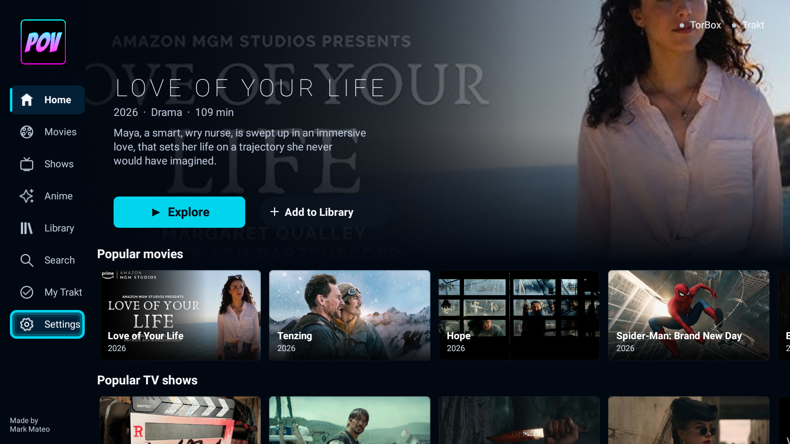
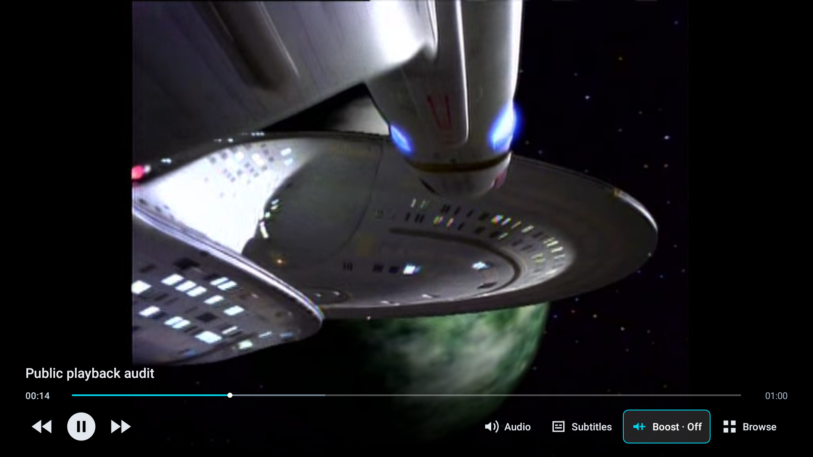
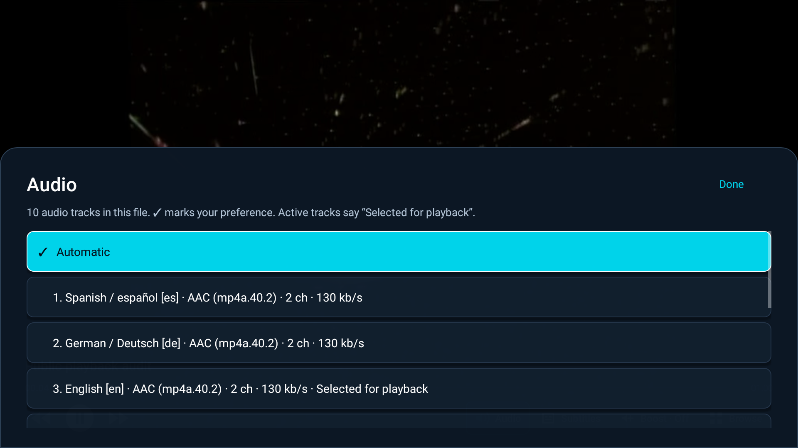
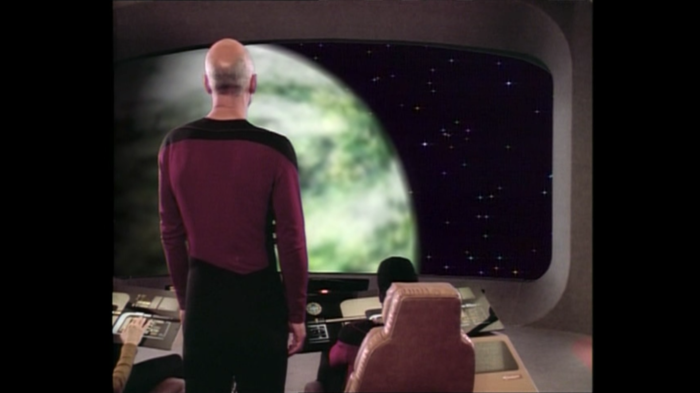
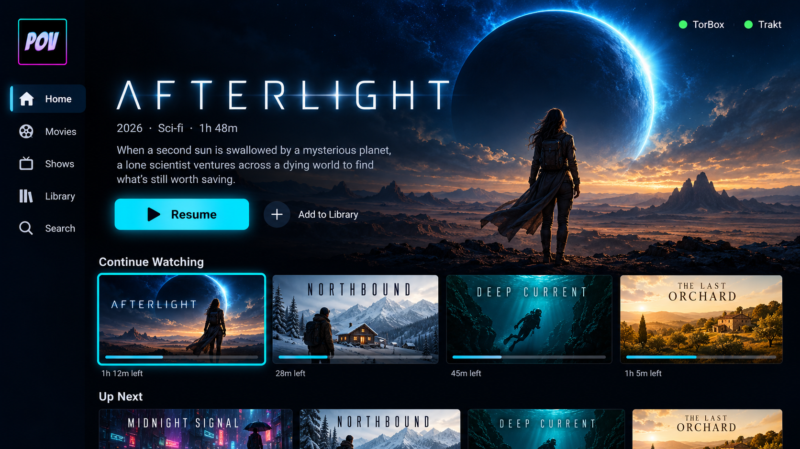
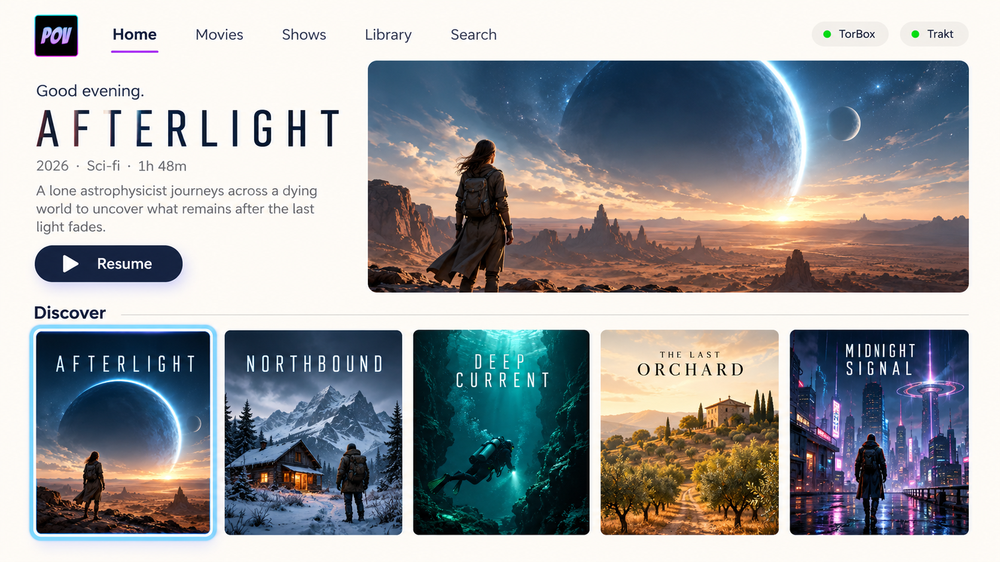
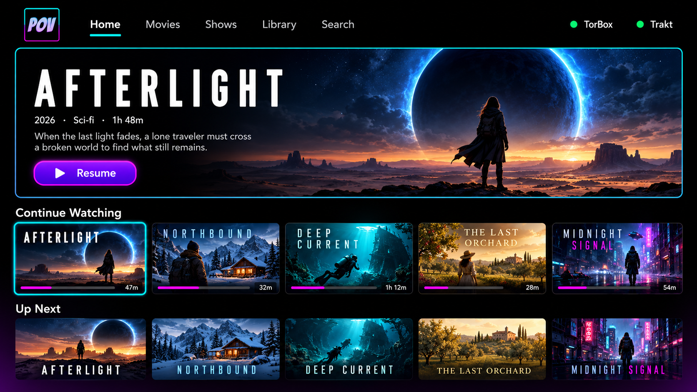
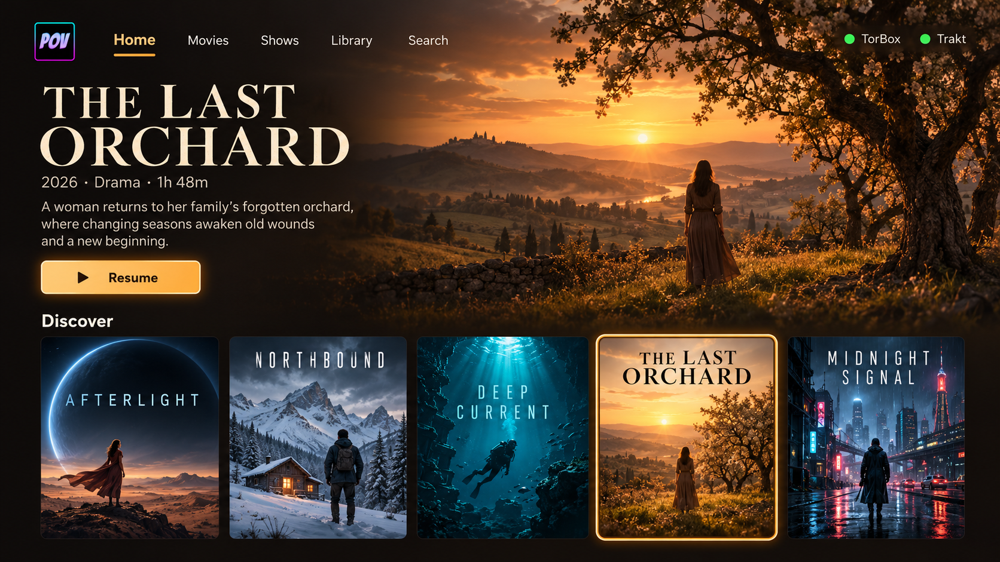
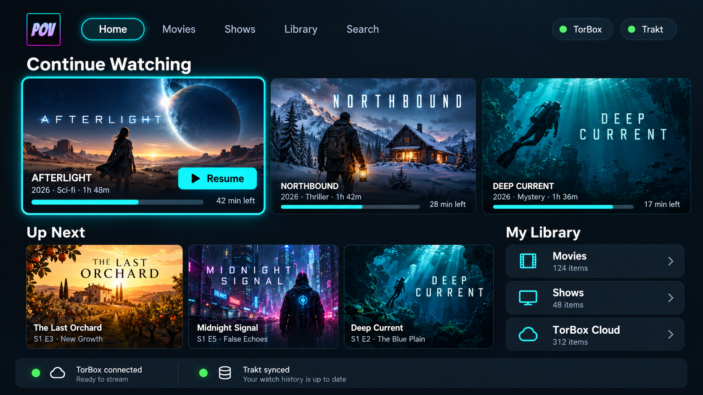

# POV Standalone for Android TV

**Standalone app made by Mark Mateo. Based on the original POV Kodi add-on by [kodifitzwell](https://github.com/kodifitzwell/repo).**

An independent native Android TV app with movie/show browsing, a dedicated Anime section, five selectable appearances, TorBox playback, and Trakt tracking. Kodi is not installed, embedded, or required at runtime. The current source version is **0.2.2-preview** (`versionCode 5`) for Android TV 8.0 or later.

[Preview release](https://github.com/MM-482/pov-android-tv/releases/tag/v0.2.2-preview) · [Source repository](https://github.com/MM-482/pov-android-tv) · [Installation and account setup](docs/INSTALL.md) · [Privacy](docs/PRIVACY.md) · [Current scope and roadmap](docs/ROADMAP.md) · [Local audit record](docs/AUDIT_0.2.2.md) · [Change notes](docs/RELEASE_NOTES_0.2.2.md)

**Bring your own accounts:** no TorBox/Trakt login information, passwords, API keys, tokens, or Trakt application Client ID are bundled. Trakt currently requires each user to register their own application and enter its Client ID; this is a preview limitation, explained in the installation guide.

## 0.2.2 preview audit

This update adds a compact 124 dp integrated bottom player controller, complete audio/subtitle track enumeration, explicit source and video-version choices, and a video-compatibility guard. It also retains remote focus and Back restoration, selected-season episode lists, anime season/cour mappings, a shared fullscreen/mini player, session volume boost, and guards against late account responses saving old state.

The current revision passed the full central suite: **227 tests, 0 failures, 0 errors, and 0 skipped**. Lint reported **0 errors / 56 warnings**, and the debug APK assembled successfully. The combined public-sample playback audit passed on the Sony Android 8 TV, including audio/subtitle selection, controller geometry and hiding, decoded PCM boost processing, fullscreen/mini handoffs, visible video motion, and decoder progress. The final offline source/file-choice fixture passed seven fully visible rows in both D-pad directions, five middle-source openings, 25 middle-file selections, exact selection restoration on Back, and unchanged local history. That fixture uses synthetic choices and does not establish authenticated TorBox transfer or playback. See the [audit record](docs/AUDIT_0.2.2.md) for the exercised hardware paths and exact packaged-artifact checks, and the [change notes](docs/RELEASE_NOTES_0.2.2.md) for the implementation details.

A separate Sony episode-navigation check passed eight sequential, fully visible rows, selected S1E9, and restored the same selection after Back. Normal browsing was restored afterward. These results establish the paths exercised on this TV and public sample; broader TV, codec, HDR, HDMI audio, and authenticated-service coverage remain separate work.

| Appearance | Visual direction |
| --- | --- |
| Cinematic | Full-screen artwork, a slim left rail, and cyan focus highlights. |
| Editorial | A light ivory canvas, a split feature area, and a clean poster collection. |
| Neon | True black, a framed feature, and cyan/magenta accents inspired by POV. |
| Cinema | Warm charcoal, amber focus, and film-inspired typography. |
| Dashboard | Large resume tiles, next episodes, and quick library access. |

Open **Settings → Appearance → Themes** to choose a look. The choice is saved on the device. Appearance changes are separate from account connections and playback history. Cinematic remains the default and the launcher retains the selected Neon POV identity (icon 3).

## App previews

These reviewed actual Sony TV captures show the Cinematic guest home and public-sample playback. They contain no connected account page or personal viewing history. They illustrate the UI; they do not establish complete hardware, account playback, or synchronization results.

The Cinematic capture shows the actual guest home. Gray account indicators are intentional in this guest view.



The player captures show the implemented controls, audio sheet, and controls hidden while playing a public sample.







Actual captures of the Editorial, Neon, Cinema, and Dashboard home screens have not yet been taken. Approved actual screenshots belong in `docs/previews/`; connected account pages, activation codes, and private playback links are excluded.

<details>
<summary>Five original generated theme reference concepts</summary>

These are the original generated design references, with fictional sample content and illustrative connection indicators. They are **concepts**, not screenshots of the implemented app. The [design gallery](design/index.html) also shows these directions.

**Cinematic — generated reference concept**



**Editorial — generated reference concept**



**Neon — generated reference concept**



**Cinema — generated reference concept**



**Dashboard — generated reference concept**



</details>

## Included in this preview

- Android TV launcher entry, remote navigation, movie/show catalogs, search, details, seasons, and episodes.
- Dedicated Anime series browsing and search through Kitsu, with separate movie and special/OVA filters. Selected season/cour entries show only their explicitly mapped episodes, retaining the canonical IMDb season/episode identity used for sources and Trakt. Catalog-declared related story parts, films, OVAs, and spinoffs are grouped separately.
- TorBox device-code authorization or a user-provided API key, torrent/Usenet/web-download cloud libraries, explicit file-version choice, cache checking, and playback-link generation. Middle rows use stable file identities and remain reachable by D-pad.
- Stremio-compatible source discovery, using the provider endpoint referenced by POV's Torrentio integration by default. A different HTTPS provider can be configured.
- Native AndroidX Media3 playback, a shared fullscreen/mini playback session, a 124 dp integrated bottom controller, complete embedded audio/subtitle track lists, session volume boost, local resume, and playback history.
- Trakt device-code linking, movie/show watchlists, personal lists, paused progress, up to ten recently watched shows' next episodes, add/remove watchlist actions, and watched marking.
- Trakt progress synchronization for explicitly identified movies/episodes, account-session guards, and an offline update queue with revision-safe acknowledgments.

Raw TorBox cloud files can play without a catalog match. Choose **Identify movie for Trakt** or **Identify episode for Trakt** when tracking is needed; the app does not silently mark guessed filenames as watched.

Selecting a source with multiple eligible videos opens **Choose a video version**. All eligible versions are available by filename and size, and selecting a row plays that exact file. An exact provider filename suggests initial focus without hiding other versions. A single eligible video can proceed directly. Episode choices exclude explicit mismatches and samples, and ambiguous unmarked episode packs require manual identification. Choose the correct film when a collection contains several different movies; the app cannot establish that match from a filename alone.

The video-compatibility guard pauses copies whose loaded video tracks are reported unsupported or beyond this TV's decoder capabilities. It shows the codec and resolution with **Choose another source**, suggesting a compatible copy such as 1080p H.264. Leaving that error releases the blocked playback session; the blocked copy does not create new viewing progress or Trakt scrobbles. Supported HEVC, 4K, and adaptive video remain eligible according to the player's capability reports. The unit suite includes 18 cases for this guard.

In one reported frozen-picture/continuing-audio case, the Sony Android 8 decoder reported an **8K HEVC stream at 7680×4320** as exceeding its capabilities. That is evidence of an incompatible copy in that case. The post-update compatibility error has not been physically replayed with that private copy, and this finding does not establish the cause of every freeze.

## Remote and playback controls

The focused poster, navigation item, or action has a visible outline. Moving between screens and returning with Back restores a stable selection where that item is still available. Ordinary TV details show one selected season at a time; the initial selection prefers a regular season, with specials offered separately.

Fullscreen/mini handoffs retain the existing browsing root, catalog, scroll position, and mini view. **Now playing** returns directly within the app without rebuilding the catalog. Video-surface transition animations are disabled. The incoming view takes ownership only once it is attached, shown, and has a valid video surface; the outgoing target stays attached until then when its Activity lifecycle allows. Pending attachments are canceled when their view detaches or the session stops/changes, so stale callbacks cannot steal the video output. Ten regression cases cover this readiness coordination.

Within a horizontal poster row, Right continues through that row's remaining cards, including cards that need scrolling. At its last card, Right can enter the mini-player even when another row has offscreen cards. Two additional regression cases cover those row boundaries. While the mini view is present, browsing content reserves extra space and moves covered focus above that view. The Sony audit passed Right-edge mini focus, MENU/hold-Select options, and Select returning to fullscreen while retaining the browsing root and reusing the mini view.

The public sample showed visible motion and advancing decoded-video buffers in the mini and returned fullscreen views. Paused handoffs kept the same player with **0 ms position change** in both views. Explicit Stop released the session, and the audit left local viewing history unchanged. These checks go beyond a moving timeline; they do not certify every source or TV.

| Action | Intended behavior in 0.2.2 |
| --- | --- |
| Back from fullscreen video | Return to POV browsing while the same playback session continues in the mini view. |
| Select the mini view or choose Now playing in navigation | Return to the same video and position without preparing another player. |
| MENU while browsing with active playback | Choose **Return to video** or **Stop playback**. |
| Hold Select on the mini view | Open the same Return/Stop choices when the TV reserves its MENU key for system settings. |
| MENU in the player | Open Audio, Subtitles, Volume boost, Browse while playing, or Stop playback. |
| Audio, Subtitles, or Volume boost in the bottom playback controls / MENU | Open the corresponding playback sheet. Done or Back closes that sheet. |
| Stop playback | Save local progress and release the active player session. |
| Home, app switch, or all POV screens leaving the foreground | Pause playback. Returning resumes it only if it was playing before POV left the foreground. |
| Leave POV from its root screen | Confirm **Stop and leave** when a session is active. |

Audio and subtitle menus list every track exposed by the loaded video, including unknown-language and unsupported entries. Unsupported choices include an explanation rather than disappearing. **Automatic** is a selection mode; the actual selected track is indicated separately, so automatic playback is not mislabeled as a manual language choice. Available languages depend on the chosen file. External subtitle downloads are not included.

Volume boost offers Off, +3, +6, +9, and +12 dB through software gain on decoded PCM audio. Off restores the original PCM samples, and ending or stopping playback resets the selection. Processed sample values stay within the signed 16-bit bounds. The status waits until samples have actually been processed with the selected gain before calling it active. Compressed passthrough playback remains available, with boost shown as unavailable because that route bypasses PCM processing. Hardware audio offload is disabled; normal TV volume controls remain unchanged.

Two Sony Android 8 audit starts exposed a native crash during the earlier platform loudness-effect setup. This revision removes that native-effect path entirely. On the exercised decoded-audio route, the replacement audit processed **5,120 PCM frames** with +3 dB selected and then successfully reset to Off. This verifies software processing on that route; it does not certify audible HDMI gain or every audio format.

The title, loading status, timeline, transport buttons, and playback-option actions share one compact 124 dp bottom controller and hide together. Merely focusing Audio or Boost does not pin it open during playback. An opened option sheet stays available until Done or Back; paused playback can keep its controls visible. The Sony audit verified the compact geometry, complete hide behavior, and a rendered loading-indicator fixture. Its public sample exposed 10 audio tracks and four subtitle tracks; all 11 audio-menu rows were fully visible, and manual/Automatic selection plus subtitle Off were exercised.

## Build

Run these from the project directory in PowerShell:

```powershell
.\scripts\bootstrap.ps1
.\scripts\build.ps1
```

The bootstrap downloads checksum-pinned official Android command-line tools, Gradle, and Temurin Java 17 into `.tooling/`. It installs Android API 35, build tools, and platform tools for this project. The build script puts Gradle caches and generated app outputs under the task-specific temporary directory `pov-android-build-01a15a6b/`, outside OneDrive, to avoid file-locking problems. It sets `POV_BUILD_OUTPUT` to the app-output directory (`app-build/`) and exports that path for later GitHub Actions steps. It does not change global PATH or Java settings.

The default build runs `assembleDebug`, `testDebugUnitTest`, and `lintDebug`. The APK is written to `$env:POV_BUILD_OUTPUT/outputs/apk/debug/app-debug.apk` when using the script. `scripts/package.ps1` resolves that generated-output location when preparing distributable files. The preview package uses the Android debug signing key; it is intended for local sideload testing, not a store release. A release signing key should be retained by the owner before distributing future release builds.

Under `POV_BUILD_OUTPUT`, unit-test results are written to `test-results/testDebugUnitTest/` and `reports/tests/testDebugUnitTest/`. Lint writes `reports/lint-results-debug.html` and the corresponding machine-readable reports. Keep signing keys and passwords outside source control. A different CI debug key or production release key may require uninstalling the existing test app first, clearing its local data and account connections.

Requires Windows PowerShell/PowerShell, network access for the initial tool/dependency downloads, and Android TV 8.0 or later. No Python interpreter is needed by the Android app.

## Preview publication

Publication of this preview has been approved for [MM-482/pov-android-tv](https://github.com/MM-482/pov-android-tv) and the [v0.2.2-preview release](https://github.com/MM-482/pov-android-tv/releases/tag/v0.2.2-preview). The reviewed APK is a debug-signed sideload preview; publication does not change its signing or validation limits. The prepared Android workflow has not yet established a successful hosted run.

## Connect accounts

1. Open **Settings → Connect TorBox**, then approve the displayed code on your own device. A TorBox API-key entry option is also available.
2. Create a Trakt application at [Trakt Developer](https://developer.trakt.tv/apps). In the app settings, enter that application's **Client ID** and its registered callback URI. The callback defaults to `urn:ietf:wg:oauth:2.0:oob`; use the value actually registered with Trakt.
3. Choose **Connect Trakt** and approve the activation code. No Trakt client secret is bundled or required by its current device-token schema.

The app ships without the original add-on's application credentials. Account tokens are encrypted with an Android Keystore key. `allowBackup` is false, with explicit legacy backup and Android 12+ cloud/device-transfer exclusions for all nine supported storage domains. These settings cover standard Android backup mechanisms; see the [privacy document](docs/PRIVACY.md) for device storage, provider requests, removal, and platform limitations. Changing the Trakt app Client ID or disconnecting clears queued progress so another account cannot inherit it.

**Connect Trakt** immediately opens a visible connection dialog. A configured application shows the activation address, code and expiry countdown. Missing or rejected Client IDs, timeouts, expired codes and denied authorization remain visible with Retry; **Set Client ID** explains the app-registration requirement. Saving a valid Client ID immediately requests a code. The callback URI is not required to generate a device code; its registered value is used during token refresh.

## Current limits and validation boundary

The **0.2.2** revision passed **227 tests**, with **0 failures, 0 errors, and 0 skipped**. The debug APK assembled successfully and lint reported **0 errors / 56 warnings**. Warnings remain documented rather than broadly suppressed. The combined Sony public-sample playback audit and offline source/file navigation checks passed their exercised paths. Exact packaged APK/source ZIP checks and artifact identities are tracked in the [audit record](docs/AUDIT_0.2.2.md). Earlier versions' signatures or installation evidence do not validate an altered APK, and these results do not establish that every catalog title, TV, codec, or account workflow is error-free.

Public anime metadata was checked on October 22, 2026 for Attack on Titan seasons/parts/OVAs/films, Frieren, My Hero Academia season 2, and Your Name. Those checks verify catalog identity and episode scope; they do not establish video availability or successful authenticated playback. Local device/account evidence stays outside public source exports. Only reviewed guest previews belong in public documentation.

- This preview does not yet provide full POV feature parity. It does not include every upstream provider, metadata menu, Kodi skin setting, external subtitle add-on, or download-management action.
- Cinemeta supplies catalog metadata so browsing does not require a copied TMDb key. Third-party catalog/provider availability can change.
- Sources requiring custom playback headers are skipped. The app does not run a P2P client.
- Multi-video sources present explicit file choices instead of silently selecting the first, last, or largest file. Unknown episode mappings still require manual identification. Transfers that do not become ready during the bounded wait remain in TorBox for later retry.
- Authenticated TorBox streams, full Trakt list retrieval, and playback synchronization remain unverified. A linked badge alone does not establish successful playback or tracking.
- Broader codec, HDR, HDMI passthrough, audible gain, and TV compatibility remain to be tested beyond the successful Sony public-sample paths. This preview has no background playback service or system picture-in-picture mode.
- Offline Trakt updates retry at the next app launch. This preview does not run a permanent background sync service.

## Source and acknowledgments

Original POV 6.10.06: [kodifitzwell/repo](https://github.com/kodifitzwell/repo), revision `2ea2eb7f330988ade16d388d3832b8e4b60c6b24`. The inspected manifest identifies `provider-name="kodifitzwell"` and declares GNU GPL version 3. The original visual identity and fanart are credited to kodifitzwell. The chosen launcher icon was generated using the original POV identity as a reference. The original developer is not affiliated with this port. No Reddit identity is asserted.

The application source is distributed under [GNU GPL version 3](LICENSE). Runtime notices and dependency license information are included in `app/src/main/assets/`. AndroidX Media3 and Kotlin use Apache License 2.0. Service names and runtime artwork belong to their respective owners.

Public source exports include the app, build instructions, documentation, license/credits, and approved preview images. They exclude login information, the entire `inspection/`, `.tooling/`, and `verification/` directories, SDK/JDK/Gradle installations, build caches, signing material, and private account/device evidence. Those local working files are not required to build the app.

The approved preview distribution pairs the APK with its corresponding source ZIP, SHA-256 checksums, license/credits, setup guide, and validation record.
